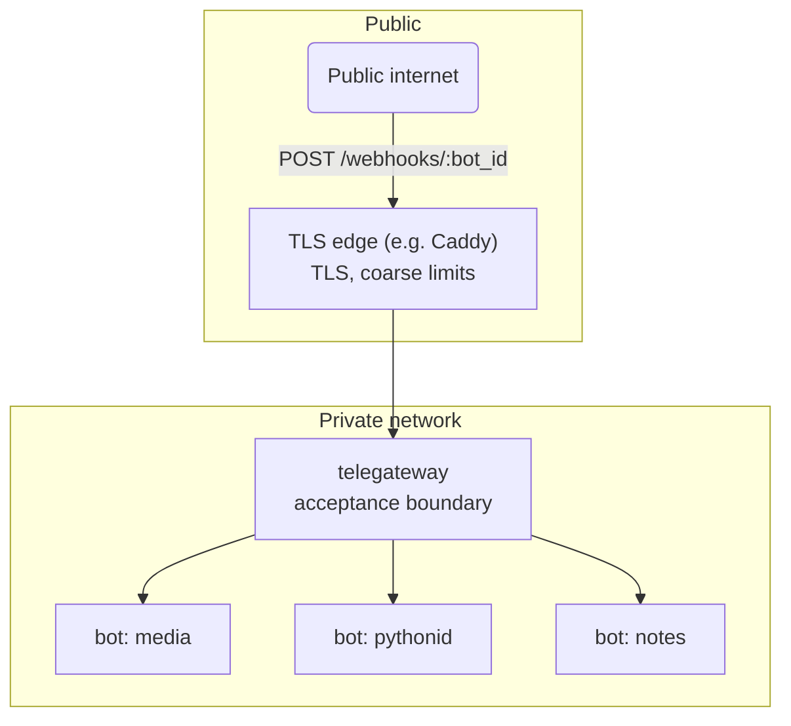

# telegateway — Architecture

## 1. Overview

telegateway is a reverse-proxy gateway for Telegram bots. It is the single
internet-facing ingress point: Telegram delivers webhook updates to it, and it
authenticates, admits, and forwards each update to the correct internal bot.

The gateway owns acceptance (is this update authentic, allowed, and
routable?). The bot owns meaning (what the update does). This separation
lets admission policy, rate limiting, and telemetry be managed once, instead
of reimplemented in every bot.

## 2. Goals and non-goals

Goals:

- Authenticate every inbound update via Telegram's webhook secret.
- Enforce per-bot and per-chat admission policy before expensive bot work.
- Route updates to the correct downstream bot over the private network.
- Emit structured, correlatable logs for every accepted update.
- Stay small: one static binary, no database, no control plane.

Non-goals:

- Running bot business logic inside the gateway.
- Generic API management (OAuth, billing, plugin marketplaces).
- Exactly-once delivery — not realistic across HTTP boundaries; the gateway
  is at-least-once with Telegram-side retries.
- Certificate issuance and renewal. The gateway can terminate TLS with
  certificates you provide, but getting and renewing them stays your job
  (certbot, Caddy, your internal CA).

## 3. System context



Trust boundaries:

- **Public boundary** — only the TLS edge and the gateway are internet-facing.
  The gateway validates the webhook secret before parsing or acting on the
  update body. The route alias (`:bot_id`) identifies a bot; it is not a
  credential.
- **Internal boundary:** downstream bots are reachable only on the private
  network. A caller that can reach a bot directly bypasses admission policy,
  so bots must never be exposed publicly.

## 4. Request lifecycle

```
1. Authenticate   verify bot exists and X-Telegram-Bot-Api-Secret-Token in constant time before parsing body
2. Adapt & Dedupe extract (update_id, kind, chat_key/user_key); check duplicate before consuming quota
3. Admit          token bucket on chat (or sender user); rejections answer 200; memory pruned hourly
4. Persist        verify outbox.max_pending cap (shed 503 if reached); write original raw bytes to outbox
5. Observe        structured log: bot_id, update_id, kind, chat
```

Delivery to the downstream bot happens asynchronously (see section 6).
The ingress path answers 200 as soon as the update is durable.

Response contract with Telegram:

| Outcome                          | Status | Rationale                                  |
| -------------------------------- | ------ | ------------------------------------------ |
| Accepted into the outbox         | 200    | Normal path; delivery is async.            |
| Duplicate update_id              | 200    | Already queued; Telegram redelivered.      |
| Rejected by admission policy     | 200    | Telegram must not retry a policy decision. |
| Malformed update / bad secret / unknown bot | 4xx | Client error; retrying won't help. Secret checked before parse. |
| Outbox unavailable / queue full  | 503    | Retryable (`max_pending` reached or DB busy); Telegram will redeliver. |
## 5. Components

| Module            | Responsibility                                                        |
| ----------------- | --------------------------------------------------------------------- |
| `config`          | TOML loading and validation. Fails fast on bad config.                |
| `app`             | Router assembly, shared `AppState`, middleware stack.                 |
| `routes::health`  | `/healthz` (liveness) and `/readyz` (readiness, checks the outbox).   |
| `routes::webhook` | The ingress handler: authenticate → adapt → admit → persist → log.    |
| `routes::admin`   | `/outbox` listing and `/outbox/replay`, bearer-token guarded.          |
| `outbox::store`   | SQLite persistence: insert, atomic claim, retry bookkeeping, prune.    |
| `outbox::dispatch`| Per-bot delivery tasks with exponential-backoff retries; janitor.     |
| `outbox::breaker` | Per-bot circuit breaker: fast-fail while downstream is down.          |
| `telegram`        | Adapter: raw Telegram JSON → routing envelope.                        |
| `policy`          | Per-bot, per-chat token-bucket admission control.                     |

## 6. Durability: the outbox

An accepted update is a promise. The gateway keeps it in SQLite (WAL mode)
before answering Telegram, so a crashed or downed bot loses nothing.

- **Ingest** writes the original raw JSON bytes with `INSERT OR IGNORE` on
  `(bot_id, update_id)`; a Telegram redelivery is a no-op. If a bot's pending
  plus in-flight rows reach `outbox.max_pending`, new updates are shed with 503.
- **Delivery** runs one task per bot. It claims due rows atomically
  (`UPDATE ... RETURNING`, bumping `attempts`), forwards each downstream
  with a 5s connect timeout, 25s total timeout, no redirect following, and the
  gateway correlation headers. Timeout yields status 504. Delivery errors
  strip downstream and Telegram URLs to prevent credential leaks.
- **Downstream status**: 4xx responses (except 408, 425, 429) dead-letter
  immediately and do not trip the circuit breaker. `Retry-After` headers on
  429 and 503 are honored.
- **Retries** back off exponentially (5s doubling, ±20% jitter, capped at
  1h). After `outbox.max_attempts` failures the row is dead-lettered with
  its last error; `GET /outbox` lists the trail.
- **Crashes**: on open, rows left `in_flight` are requeued as `pending`,
  preserving existing backoff. Delivery is at-least-once; downstream bots
  dedupe on `update_id`.
- **Circuit breaker**: each bot has an in-memory breaker (closed → open →
  half-open). After `circuit_breaker.failure_threshold` consecutive
  failures the dispatcher stops attempting delivery entirely instead of
  burning retry attempts against a dead endpoint; requeuing rows while open
  no longer increments attempts. After `circuit_breaker.cooldown_secs` one
  probe goes out: success closes the breaker and wakes the bot's pending rows
  for immediate drain; failure reopens it with a doubled cooldown, capped at
  `max_cooldown_secs`. State is in-memory like the rate limiter.
- **Hygiene & Schema**: a janitor prunes delivered rows after
  `outbox.delivered_retention_days` (default 7) and dead letters after
  30 days or beyond `outbox.max_dead_letters` per bot (oldest first). The schema enforces a status CHECK constraint and has an
  index tuned for atomic claims.
- **Ordering**: per-chat order is preserved (a failed row stops its chat's later rows until retried), with no ordering across chats. Delivery concurrency defaults to 1 (pure sequential delivery); when configured higher, updates for different chats are delivered concurrently up to `outbox.delivery_concurrency`, while updates for the same chat remain strictly sequential in update_id order. Downstream must deduplicate on `update_id`.
One crate, one binary.

## 6. Design patterns

The codebase uses a small set of patterns, each mapped to the problem it
solves:

- **Decorator** — cross-cutting concerns (request tracing, body-size limit,
  timeout, concurrency guard) are Tower layers wrapping the core router. Each
  layer adds behavior without changing the handler.
- **Chain of Responsibility** — the webhook handler is a pipeline of stages
  (authenticate → adapt → admit → forward). Each stage either passes the
  request on or terminates it with a response.
- **Strategy** — admission policy is selected per bot from configuration
  (per-bot quotas over a shared token-bucket mechanism). Storage and retry
  strategies are the seam for the durable-outbox roadmap item.
- **Adapter** — `telegram::envelope` converts Telegram's update JSON into the
  gateway's internal routing envelope. The gateway never interprets bot
  business logic; it only needs `update_id`, kind, and chat key.
- **Observer** — every forwarding decision emits a structured tracing event;
  log sinks, and later metrics exporters, subscribe without the handler
  knowing about them.
- **State** (roadmap) — the planned per-bot circuit breaker is a state
  machine: closed → open → half-open.

Not used: inheritance hierarchies, singletons, plugin frameworks. Shared
state is an explicit `Arc<AppState>`.

## 7. Configuration

TOML file, validated at startup; the process refuses to start on invalid
config rather than serving with a half-loaded one. Secrets come from the file
(or the environment via the operator's secret management); they never appear
in logs or error responses.

With `auto_register = true` and `public_url` set, the gateway calls
`setWebhook` for every bot that has a `bot_token` when it starts, in a
background task after the listener binds, retrying failures with backoff.
Bots without a token are skipped.
## 8. Security

- Webhook secrets are compared in constant time.
- Unknown bot ids return 404 without distinguishing "no such bot" from
  "wrong secret" beyond the status code — both are unauthenticated callers.
- Request bodies are capped at 1 MiB; Telegram updates are a few KiB.
- The gateway adds `X-Telegateway-Bot` and `X-Telegateway-Update-Id` headers
  downstream so bots can correlate and deduplicate (`update_id` is unique per
  bot).
- Outbound TLS uses Rustls with bundled roots; no OpenSSL dependency.

## 9. Observability

- JSON structured logs via `tracing`; verbosity controlled by `RUST_LOG`.
- Every forwarded update logs `bot_id`, `update_id`, update kind, chat key,
  downstream status, and latency in milliseconds.
- Rejections log the reason (`bad webhook secret`, `rate limited`, …) at
  `WARN`.
- `/healthz` and `/readyz` are scrape-friendly probes for orchestrators.
- OpenTelemetry (optional, via `[otel]`): traces and metrics exported over
  OTLP/HTTP to a collector. Spans cover ingress, delivery, breaker probes,
  replays, and webhook registration; metrics are per-bot counters (accepted,
  delivered, failed, dead-lettered, replayed), delivery latency, pending
  outbox depth, and breaker state (0 closed / 1 open / 2 half-open).
Downstream requests carry W3C `traceparent` headers. Export is batched and
async — a dead collector only drops telemetry, never requests. Outbox gauge
reports 0 for idle bots. SIGTERM / SIGINT trigger graceful shutdown with
provider flush; dispatchers finish any in-flight delivery before stopping.
If a dispatcher task exits unexpectedly, the process terminates with non-zero
status so the orchestrator can restart it. SIGHUP triggers live reloading of
TLS certificate and private key files.
## 10. Failure handling

- The outbox is the durability boundary: once Telegram gets a 200, the
  update survives gateway restarts and downstream outages.
- A 503 tells Telegram to retry; a policy rejection answers 200 so abusive
  traffic is not amplified by retries.
- Delivery is at-least-once; downstream bots dedupe on `update_id`.
- `ConcurrencyLimitLayer` (512) and `LoadShedLayer` bound in-flight ingress work;
  excess connections are shed with 503 instead of queueing unboundedly.
- Panics in a handler cannot take down the process: each connection is an
  independent Tokio task.
## 11. Deployment

Single static binary. Recommended topology: TLS edge → telegateway →
bots, all on one private container network. Without an edge, the gateway
terminates TLS itself from the `[tls]` config section. The gateway keeps
local state in the outbox SQLite file (bind-mounted or on a volume in
containers); rate-limiter state is in-memory and safe to lose. Single-node
by design: replicating the gateway would need shared outbox storage.
