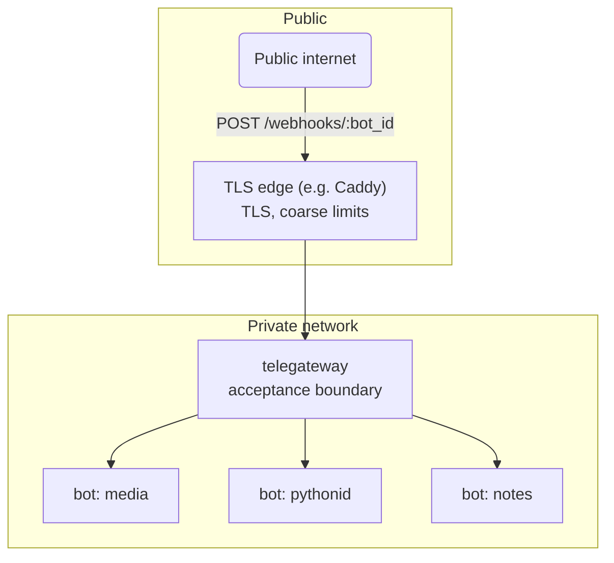

# telegateway — Architecture

## 1. Overview

telegateway is a reverse-proxy gateway for Telegram bots. It is the single
internet-facing ingress point: Telegram delivers webhook updates to it, and it
authenticates, admits, and forwards each update to the correct internal bot.

The gateway owns acceptance (is this update authentic, allowed, and
routable?). The bot owns meaning (what the update does). This separation
lets admission policy, rate limiting, and telemetry be managed once, instead
of reimplemented in every bot.

## 2. Goals and non-goals

Goals:

- Authenticate every inbound update via Telegram's webhook secret.
- Enforce per-bot and per-chat admission policy before expensive bot work.
- Route updates to the correct downstream bot over the private network.
- Emit structured, correlatable logs for every accepted update.
- Stay small: one static binary, no database, no control plane.

Non-goals:

- Running bot business logic inside the gateway.
- Generic API management (OAuth, billing, plugin marketplaces).
- Exactly-once delivery — not realistic across HTTP boundaries; the gateway
  is at-least-once with Telegram-side retries.
- Certificate issuance and renewal. The gateway can terminate TLS with
  certificates you provide, but getting and renewing them stays your job
  (certbot, Caddy, your internal CA).

## 3. System context



Trust boundaries:

- **Public boundary** — only the TLS edge and the gateway are internet-facing.
  The gateway validates the webhook secret before parsing or acting on the
  update body. The route alias (`:bot_id`) identifies a bot; it is not a
  credential.
- **Internal boundary:** downstream bots are reachable only on the private
  network. A caller that can reach a bot directly bypasses admission policy,
  so bots must never be exposed publicly.

## 4. Request lifecycle

```
1. Authenticate   verify X-Telegram-Bot-Api-Secret-Token in constant time
2. Adapt          extract (update_id, kind, chat_key) from the raw JSON
3. Admit          per-chat token bucket; rejections answer 200
4. Forward        POST the raw body to downstream_url (25s timeout)
5. Observe        structured log: bot_id, update_id, kind, chat, status, latency
```

Response contract with Telegram:

| Outcome                          | Status | Rationale                                  |
| -------------------------------- | ------ | ------------------------------------------ |
| Forwarded (downstream 2xx)       | 200    | Normal delivery.                           |
| Rejected by admission policy     | 200    | Telegram must not retry a policy decision. |
| Malformed update / bad secret / unknown bot | 4xx | Client error; retrying won't help.  |
| Downstream unreachable or 5xx    | 502    | Retryable; Telegram will redeliver.        |

## 5. Components

| Module            | Responsibility                                                        |
| ----------------- | --------------------------------------------------------------------- |
| `config`          | TOML loading and validation. Fails fast on bad config.                |
| `app`             | Router assembly, shared `AppState`, middleware stack.                 |
| `routes::health`  | `/healthz` (liveness) and `/readyz` (readiness) probes.               |
| `routes::webhook` | The ingress handler: authenticate → adapt → admit → forward → log.    |
| `telegram`        | Adapter: raw Telegram JSON → routing envelope.                        |
| `policy`          | Per-bot, per-chat token-bucket admission control.                     |

One crate, one binary.

## 6. Design patterns

The codebase uses a small set of patterns, each mapped to the problem it
solves:

- **Decorator** — cross-cutting concerns (request tracing, body-size limit,
  timeout, concurrency guard) are Tower layers wrapping the core router. Each
  layer adds behavior without changing the handler.
- **Chain of Responsibility** — the webhook handler is a pipeline of stages
  (authenticate → adapt → admit → forward). Each stage either passes the
  request on or terminates it with a response.
- **Strategy** — admission policy is selected per bot from configuration
  (per-bot quotas over a shared token-bucket mechanism). Storage and retry
  strategies are the seam for the durable-outbox roadmap item.
- **Adapter** — `telegram::envelope` converts Telegram's update JSON into the
  gateway's internal routing envelope. The gateway never interprets bot
  business logic; it only needs `update_id`, kind, and chat key.
- **Observer** — every forwarding decision emits a structured tracing event;
  log sinks, and later metrics exporters, subscribe without the handler
  knowing about them.
- **State** (roadmap) — the planned per-bot circuit breaker is a state
  machine: closed → open → half-open.

Not used: inheritance hierarchies, singletons, plugin frameworks. Shared
state is an explicit `Arc<AppState>`.

## 7. Configuration

TOML file, validated at startup; the process refuses to start on invalid
config rather than serving with a half-loaded one. Secrets come from the file
(or the environment via the operator's secret management); they never appear
in logs or error responses.

## 8. Security

- Webhook secrets are compared in constant time.
- Unknown bot ids return 404 without distinguishing "no such bot" from
  "wrong secret" beyond the status code — both are unauthenticated callers.
- Request bodies are capped at 1 MiB; Telegram updates are a few KiB.
- The gateway adds `X-Telegateway-Bot` and `X-Telegateway-Update-Id` headers
  downstream so bots can correlate and deduplicate (`update_id` is unique per
  bot).
- Outbound TLS uses Rustls with bundled roots; no OpenSSL dependency.

## 9. Observability

- JSON structured logs via `tracing`; verbosity controlled by `RUST_LOG`.
- Every forwarded update logs `bot_id`, `update_id`, update kind, chat key,
  downstream status, and latency in milliseconds.
- Rejections log the reason (`bad webhook secret`, `rate limited`, …) at
  `WARN`.
- `/healthz` and `/readyz` are scrape-friendly probes for orchestrators.

## 10. Failure handling

- Downstream timeout (25s) is shorter than the gateway timeout (30s), so the
  gateway always owns the response to Telegram.
- A 502 tells Telegram to retry; a policy rejection answers 200 so abusive
  traffic is not amplified by retries.
- `ConcurrencyLimitLayer` (512) bounds in-flight work; excess connections
  wait instead of piling onto the bot.
- Panics in a handler cannot take down the process: each connection is an
  independent Tokio task.

## 11. Deployment

Single static binary. Recommended topology: TLS edge → telegateway →
bots, all on one private container network. Without an edge, the gateway
terminates TLS itself from the `[tls]` config section. The gateway is
stateless today (rate-limiter state is in-memory and safe to lose), so it
can be replicated behind the edge once needed.

## 12. Roadmap

1. **Durable outbox** — persist accepted updates, acknowledge Telegram
   immediately, deliver asynchronously with bounded retries and a dead-letter
   trail.
2. **Replay API** — re-deliver a recorded update to a bot for debugging.
3. **OpenTelemetry export** — traces and metrics to a collector.
4. **Circuit breaker** — per-bot open/half-open/closed state with fast-fail.
